<h1 align="center">Hi, I'm jinyinzao-blog</h1>

  
  

## Featured Projects

<table>
  <tr>
    <td valign="top" width="50%">
      <h3><a href="https://github.com/jinyinzao-blog/jinyinzao-blog.github.io">jinyinzao-blog.github.io</a></h3>
      
基于 HTML 和 GitHub Pages 搭建的个人博客

      
`HTML` · ★ 0 · ⑂ 0

    </td>
    <td valign="top" width="50%">
      <h3><a href="https://github.com/jinyinzao-blog/jinyinzao-blog">jinyinzao-blog</a></h3>
      
我的 GitHub 个人主页

      
★ 0 · ⑂ 0

    </td>
  </tr>
</table>

## By the numbers

- **0** total stars earned
- **2** public repositories
- **0** followers

Generated by <a href="https://github.com/bobfromarcher/ghcard">ghcard</a> - no third-party services, just SVG.

